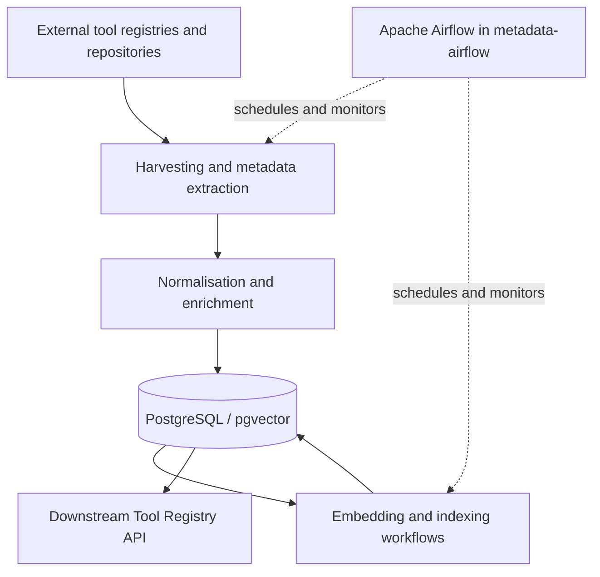

# Tool Metadata Harvester

**Metadata harvesting and enrichment pipelines for the EOSC Data Commons Catalogue of Tools.**

The Tool Metadata Harvester collects descriptions of research software, computational tools, and workflows from external registries and software repositories. It transforms source-specific records into a common metadata representation and persists them in PostgreSQL for discovery, indexing, and downstream matching services.

> **Deployment:** This project is designed to run as scheduled workflows in **Apache Airflow**. For the shared Airflow infrastructure, installation, and operational instructions, see **[EOSC Data Commons — metadata-airflow](https://github.com/EOSC-Data-Commons/metadata-airflow)**. This repository contains the harvester implementation and its Airflow DAG definitions; it is not a standalone Airflow deployment.

## What it does

The harvester supports the tool discovery infrastructure developed within EOSC Data Commons. Its responsibilities include:

- **Collecting metadata** from tool registries, workflow catalogues, and software repositories.
- **Normalising records** from different metadata formats into a consistent representation suitable for the Catalogue of Tools.
- **Maintaining records in PostgreSQL**, including source information and metadata updates.
- **Supporting incremental harvesting** so recurring runs can refresh existing records rather than blindly duplicating them.
- **Enriching metadata for discovery**, including generation and storage of text embeddings for semantic search.
- **Exposing harvesting workflows as Airflow DAGs** for scheduled and monitored execution.

The collection and transformation code lives in this repository. The user-facing catalogue and its search API are separate components.

## Architecture



Airflow orchestrates the pipelines and provides scheduling, task execution, logging, and monitoring. The harvester library implements the work performed by those tasks. PostgreSQL holds the harvested metadata, provenance/source information, and vector representations used by downstream search functionality.

## Repository layout

| Path | Purpose |
| --- | --- |
| `src/toolmeta_harvester/` | Python package with harvesting and metadata-processing logic. |
| `src/toolmeta_harvester/flows/` | Harvesting flows that can also be used during local development. |
| `airflow_dags/` | DAG entry points for Airflow to discover and schedule. |
| `config/` | Application configuration and local secrets configuration. |
| `docker/postgres/init/` | Initialisation scripts for the local PostgreSQL environment. |
| `pyproject.toml`, `uv.lock` | Python package metadata and dependency lockfile. |
| `Makefile` | Development helper commands. |

## Running with Apache Airflow (recommended)

The shared deployment is maintained separately in **[metadata-airflow](https://github.com/EOSC-Data-Commons/metadata-airflow)**. It uses Apache Airflow with CeleryExecutor, PostgreSQL, RabbitMQ, and Git DAG bundles, allowing different harvester repositories to supply their own pipelines.

To deploy this harvester:

1. Clone and configure the [`metadata-airflow` repository](https://github.com/EOSC-Data-Commons/metadata-airflow).
2. Install this repository as a Python package in the Airflow runtime image (scheduler, DAG processor, and workers as applicable).
3. Configure an Airflow Git DAG bundle pointing to this repository's `airflow_dags/` directory.
4. Configure the Tool Registry database connection, credentials, and other settings required by the pipelines.
5. Start the deployment and check that the DAGs are imported without errors.
6. Enable the relevant DAGs in the Airflow UI or trigger them manually.

The Airflow deployment documentation includes examples for the Python package installation and `AIRFLOW__DAG_PROCESSOR__DAG_BUNDLE_CONFIG_LIST` configuration.

**Version consistency:** Use the same Git tag or commit for the installed Python package and the Airflow DAG bundle. A DAG fetched from a newer revision may import functions that are not available in an older installed package.

### Useful Airflow commands

Run these from the `metadata-airflow` repository:

```bash
make up                 # Start the Airflow deployment
make dags               # List discovered DAGs
make dags-errors        # Inspect DAG import errors
```

The Airflow UI is available at `http://localhost:8080` with the default local deployment configuration. Refer to [`metadata-airflow` documentation](https://github.com/EOSC-Data-Commons/metadata-airflow) for environment setup, service commands, and troubleshooting.

## Local development

Local development can be performed independently of the shared Airflow infrastructure. The repository provides a Makefile and a local PostgreSQL setup for running and debugging harvesting flows.

### Requirements

- Python 3.12 or newer
- [`uv`](https://docs.astral.sh/uv/) for Python environment management
- Docker for the local PostgreSQL database
- Source-specific credentials, where required (for example, a GitHub API token)

### Install

```bash
git clone https://github.com/EOSC-Data-Commons/toolmeta-harvester.git
cd toolmeta-harvester
```

Configure any required secrets in `config/.secrets.toml`, then run:

```bash
make install
```

The Makefile starts a PostgreSQL container and installs the project dependencies. For a dependency-only setup, use:

```bash
uv sync
```

### Run a harvesting flow locally

```bash
make run
```

This target displays the available flow scripts and the command pattern for executing one; it **does not** itself start a harvesting job. Select a flow and run it, for example:

```bash
uv run src/toolmeta_harvester/flows/<flow_name>.py
```

Replace `<flow_name>` with a script present in the `flows/` directory. Some flows may require additional configuration, external service access, or a running database.

### Local database

Useful Makefile targets include:

```bash
make postgres-up       # Start local PostgreSQL
make postgres-down     # Stop local PostgreSQL
make postgres-shell    # Open a psql shell
make postgres-reset    # Remove the docker volume
```

The local database uses a PostgreSQL image with the `pgvector` extension available for embedding storage and similarity search. 

> **Warning:** Local credentials and port settings in the Makefile are intended for development. Configure secure credentials and appropriate networking for production deployments.

## Adding or maintaining a harvester

Harvesting pipelines should keep source-specific API access and metadata extraction separate from shared persistence and orchestration concerns. When introducing a new source, implement and test the source-specific extraction and transformation code in the Python package, then expose the workflow through the applicable Airflow DAG definitions.

Recurring harvesting should account for source identifiers and updates so that rerunning a pipeline does not create duplicate records. Changes to the database schema should be managed through Alembic migrations.

When adding a DAG or changing a pipeline's callable interface, update the Airflow deployment to use a matching version of the package and DAG bundle. Operational settings such as schedules, task retries, and worker configuration belong to the Airflow execution environment.

## Related repositories

- **[metadata-airflow](https://github.com/EOSC-Data-Commons/metadata-airflow)** — Shared Airflow infrastructure that schedules and executes harvesting DAGs.
- **[EOSC Data Commons](https://github.com/EOSC-Data-Commons)** — Organisation repositories for associated metadata, catalogue, and data discovery components.

## Project status

The project is under active development. Supported sources, metadata mappings, database models, and workflow interfaces may evolve. Consult the repository's source code and commit history for the current implementation.

## License

Licensed under the [Apache License 2.0](LICENSE).
