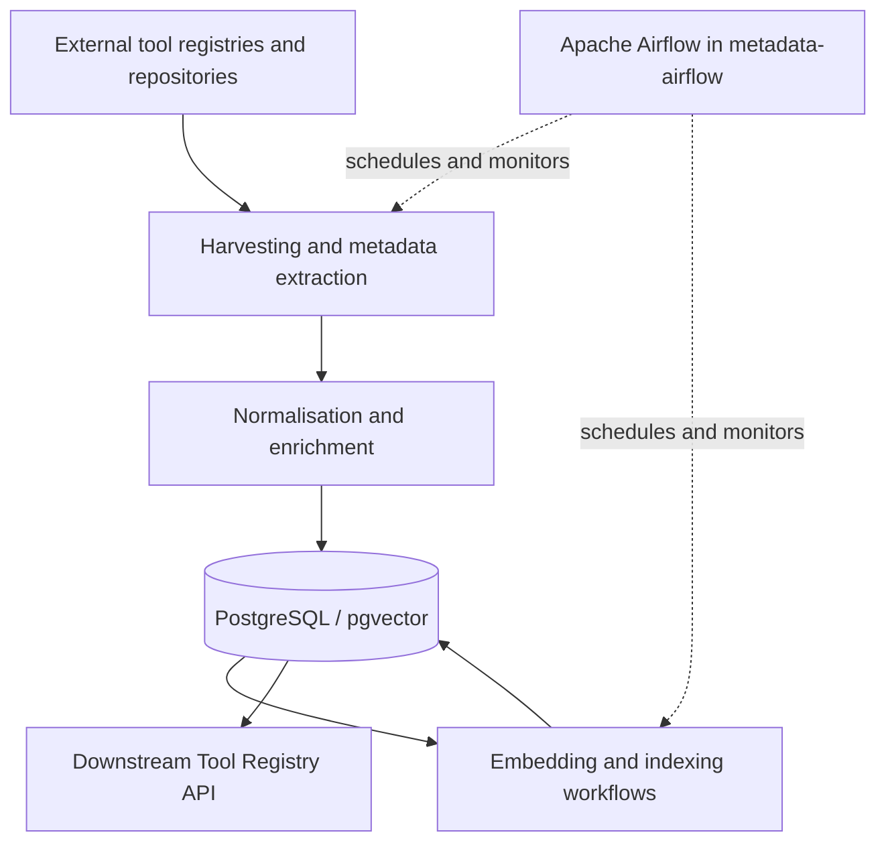

# Tool Metadata Harvester

**Metadata harvesting and enrichment pipelines for the EOSC Data Commons Catalogue of Tools.**

The Tool Metadata Harvester collects descriptions of research software, computational tools, and workflows from external registries and software repositories. It transforms source-specific records into a common metadata representation and persists them in PostgreSQL for discovery, indexing, and downstream matching services.

> **Deployment:** This project is designed to run as scheduled workflows in **Apache Airflow**. For the shared Airflow infrastructure, installation, and operational instructions, see **[EOSC Data Commons — metadata-airflow](https://github.com/EOSC-Data-Commons/metadata-airflow)**. This repository contains the harvester implementation and its Airflow DAG definitions; it is not a standalone Airflow deployment.

## What it does

The harvester supports the tool discovery infrastructure developed within EOSC Data Commons. Its responsibilities include:

- **Collecting metadata** from tool registries, workflow catalogues, and software repositories.
- **Normalising records** from different metadata formats into a consistent representation suitable for the Catalogue of Tools.
- **Maintaining records in PostgreSQL**, including source information and metadata updates.
- **Supporting incremental harvesting** so recurring runs can refresh existing records rather than blindly duplicating them.
- **Enriching metadata for discovery**, including generation and storage of text embeddings for semantic search.
- **Exposing harvesting workflows as Airflow DAGs** for scheduled and monitored execution.

The collection and transformation code lives in this repository. The user-facing catalogue and its search API are separate components.

## Architecture



Airflow orchestrates the pipelines and provides scheduling, task execution, logging, and monitoring. The harvester library implements the work performed by those tasks. PostgreSQL holds the harvested metadata, provenance/source information, and vector representations used by downstream search functionality.

## Repository layout

| Path | Purpose |
| --- | --- |
| `src/toolmeta_harvester/` | Python package with harvesting and metadata-processing logic. |
| `src/toolmeta_harvester/flows/` | Harvesting flows that can also be used during local development. |
| `airflow_dags/` | DAG entry points for Airflow to discover and schedule. |
| `config/` | Application configuration and local secrets configuration. |
| `docker/postgres/init/` | Initialisation scripts for the local PostgreSQL environment. |
| `pyproject.toml`, `uv.lock` | Python package metadata and dependency lockfile. |
| `Makefile` | Development helper commands. |

## Running with Apache Airflow (recommended)

The shared deployment is maintained separately in **[metadata-airflow](https://github.com/EOSC-Data-Commons/metadata-airflow)**. It uses Apache Airflow with CeleryExecutor, PostgreSQL, RabbitMQ, and Git DAG bundles, allowing different harvester repositories to supply their own pipelines.

To deploy this harvester:

1. Clone and configure the [`metadata-airflow` repository](https://github.com/EOSC-Data-Commons/metadata-airflow).
2. Install this repository as a Python package in the Airflow runtime image (scheduler, DAG processor, and workers as applicable).
3. Configure an Airflow Git DAG bundle pointing to this repository's `airflow_dags/` directory.
4. Configure the Tool Registry database connection, credentials, and other settings required by the pipelines.
5. Start the deployment and check that the DAGs are imported without errors.
6. Enable the relevant DAGs in the Airflow UI or trigger them manually.

The Airflow deployment documentation includes examples for the Python package installation and `AIRFLOW__DAG_PROCESSOR__DAG_BUNDLE_CONFIG_LIST` configuration.

**Version consistency:** Use the same Git tag or commit for the installed Python package and the Airflow DAG bundle. A DAG fetched from a newer revision may import functions that are not available in an older installed package.

### Useful Airflow commands

Run these from the `metadata-airflow` repository:

```bash
make up                 # Start the Airflow deployment
make dags               # List discovered DAGs
make dags-errors        # Inspect DAG import errors
```

The Airflow UI is available at `http://localhost:8080` with the default local deployment configuration. Refer to [`metadata-airflow` documentation](https://github.com/EOSC-Data-Commons/metadata-airflow) for environment setup, service commands, and troubleshooting.

## Local development

Local development can be performed independently of the shared Airflow infrastructure. The repository provides a Makefile and a local PostgreSQL setup for running and debugging harvesting flows.

### Requirements

- Python 3.12 or newer
- [`uv`](https://docs.astral.sh/uv/) for Python environment management
- Docker for the local PostgreSQL database
- Source-specific credentials, where required (for example, a GitHub API token)

### Install

```bash
git clone https://github.com/EOSC-Data-Commons/toolmeta-harvester.git
cd toolmeta-harvester
```

Configure any required secrets in `config/.secrets.toml`, then run:

```bash
make install
```

The Makefile starts a PostgreSQL container and installs the project dependencies. For a dependency-only setup, use:

```bash
uv sync
```

### Run a harvesting flow locally

```bash
make run
```

This target displays the available flow scripts and the command pattern for executing one; it **does not** itself start a harvesting job. Select a flow and run it, for example:

```bash
uv run src/toolmeta_harvester/flows/<flow_name>.py
```

Replace `<flow_name>` with a script present in the `flows/` directory. Some flows may require additional configuration, external service access, or a running database.

### Local database

Useful Makefile targets include:

```bash
make postgres-up       # Start local PostgreSQL
make postgres-down     # Stop local PostgreSQL
make postgres-shell    # Open a psql shell
make postgres-reset    # Remove the docker volume
```

The local database uses a PostgreSQL image with the `pgvector` extension available for embedding storage and similarity search. 

> **Warning:** Local credentials and port settings in the Makefile are intended for development. Configure secure credentials and appropriate networking for production deployments.

## Adding or maintaining a harvester

Harvesting pipelines should keep source-specific API access and metadata extraction separate from shared persistence and orchestration concerns. When introducing a new source, implement and test the source-specific extraction and transformation code in the Python package, then expose the workflow through the applicable Airflow DAG definitions.

Recurring harvesting should account for source identifiers and updates so that rerunning a pipeline does not create duplicate records. Changes to the database schema should be managed through Alembic migrations.

When adding a DAG or changing a pipeline's callable interface, update the Airflow deployment to use a matching version of the package and DAG bundle. Operational settings such as schedules, task retries, and worker configuration belong to the Airflow execution environment.

## Related repositories

- **[metadata-airflow](https://github.com/EOSC-Data-Commons/metadata-airflow)** — Shared Airflow infrastructure that schedules and executes harvesting DAGs.
- **[EOSC Data Commons](https://github.com/EOSC-Data-Commons)** — Organisation repositories for associated metadata, catalogue, and data discovery components.

## Project status

The project is under active development. Supported sources, metadata mappings, database models, and workflow interfaces may evolve. Consult the repository's source code and commit history for the current implementation.

## License

Licensed under the [Apache License 2.0](LICENSE).

## Semantic enrichment experiment (prototype)

### Goal and audit

This prototype evaluates whether existing tool metadata can support a richer,
factual semantic representation for scientific tool discovery and future
tool–dataset matching. It does not harvest additional sources or measure
retrieval quality. The database audit is recorded in
[`docs/enrichment-audit.md`](docs/enrichment-audit.md).

The local database contained 37,494 records. BioTools contributed 34,445
(91.87%), so the experiment is source-skewed. Titles and descriptions were
populated on 100% and 99.93% of records; keywords on 94.35%; software types on
80.51%. Inputs and outputs were present on 13.14% and 11.06% of records, and
`consumes_data` / `produces_data` on 10.97% / 9.09%. Input descriptions were
present for 20.1% of input entries; output descriptions for 6.8% of output
entries. Raw metadata was present on every record, with median/p95 JSONB sizes
of about 2.1/3.3 KB. BioTools `function.operation` and `topic` entries and
source-specific workflow or parameter details provide useful semantics that
are not always present in normalized input/output columns.

### Architecture and data model

The harvester remains the source of truth. The pipeline uses the existing
PostgreSQL database, SQLAlchemy models, Alembic migrations, and Airflow
orchestration. Its stages live in `src/toolmeta_harvester/enrichment/`:

1. **Extraction** converts focused source metadata into validated structured
   fields: input/output descriptions, supported tasks, methods and techniques,
   and scientific domains.
2. **Generation** writes a concise `enriched_description` grounded in the
   source fields and extraction result.
3. **Validation** checks the generated result with deterministic schema checks
   and a separate LLM review. Scores range from 0 (unsupported/unusable) to 5
   (strongly supported/useful); they are advisory, not ground truth.
4. **Embedding** is a separate manual stage that embeds validated
   `enriched_description` text in the existing 768-dimensional
   `ToolEmbedding` model. It is not run as part of the initial LLM experiment.

`tool_metadata` now stores `input_description`, `output_description`,
`semantic_metadata` JSONB, `enriched_description`, `enrichment_status`,
`enrichment_input_hash`, `enrichment_version`, `enrichment_error`,
`enrichment_failed_stage`, `enrichment_validation` JSONB, and `enriched_at`.
The input hash covers only the fields sent to extraction. A source change makes
the record eligible for re-enrichment. Statuses include `pending`, `processing`,
`extracted`, `generated`, `validated`, and `failed`; retries resume at the
failed stage. A new prompt version also makes its stage eligible again when
the source metadata hash is unchanged.

The local database was already stamped at revision `7fff94b25184`, which was
not included in this checkout. The added no-op bridge records the inspected
schema baseline. Migration `8c25d72b21a4` adds enrichment columns and
`9be70ae85cc1` installs the pgvector extension and creates the
`tool_embeddings` table from the existing ORM model. These migrations were
applied locally. The pre-migration database had 37,494 tool records and no
embedding table or rows; the migration preserved all source records and left
their embedding count at zero.

### Prompts, configuration, and operation

Prompts are versioned under `src/toolmeta_harvester/enrichment/prompts/`:
`extraction_v1`, `generation_v1`, and `validation_v1`. Their identifiers are
stored with each enrichment result. The extraction prompt explicitly leaves
unknowns empty and tells the model not to infer scientific meaning from a
generic `File` type. Raw metadata is pruned to an allowlist of semantic keys;
IDs, owners, timestamps, links, and unrelated operational fields are excluded.

Configure the EGI chat client with environment variables:

| Variable | Default / purpose |
| --- | --- |
| `LLM_EGI_API_URL` | `https://llm.ai.egi.eu/chat/completions` |
| `LLM_EGI_API_KEY` | Required secret; do not commit or log it |
| `LLM_EGI_MODEL` | `qwen3.8-27b` |
| `LLM_EGI_TIMEOUT` | 180 seconds per request |
| `LLM_EGI_MAX_RETRIES` | 3 retries for transient failures |

For a local CLI run, configure the database connection through
`TOOLMETA_HARVESTER_DATABASE__HOST`, `...__PORT`, `...__NAME`, `...__USER`,
and `...__PASSWORD` as needed. The local Airflow development override forwards
the sibling warehouse's database settings to the default worker and passes
through the LLM environment variables. Set `LLM_EGI_API_KEY` in the local
`metadata-warehouse/.env` before triggering the DAGs.

The Airflow image uses Python 3.13 while the harvester uses Python 3.12. The
DAGs therefore dispatch the enrichment CLI in the dedicated harvester virtual
environment. The warehouse Airflow Dockerfile installs Pydantic v2 into that
environment; rebuild the Airflow image and recreate the default worker after
updating the Dockerfile or local `.env`:

```sh
cd ../metadata-warehouse
docker compose -f docker-compose.yml -f docker-compose.dev.yml build airflow-init
docker compose -f docker-compose.yml -f docker-compose.dev.yml up -d --force-recreate airflow-worker
```

Run the deterministic 100-record experiment from the repository root:

```sh
uv sync --group dev
PYTHONPATH=src uv run alembic upgrade head
PYTHONPATH=src uv run python -m toolmeta_harvester.enrichment.experiment
```

The sample reserves one record per available metadata source, then allocates
the remaining slots proportionally. For the audited database that produces
87 BioTools, 5 WorkflowHub, 5 CodeMeta, and one record from each of Boutiques,
RO-Crate, and JSON-LD. Ordering within each source is based on a stable hash of
the record ID. The resulting manual review export is written to
`.experiment-output/tool_enrichment_100.jsonl` (ignored by Git).

The four manually triggered Airflow DAGs are:

- `tool_metadata_enrichment_extraction`
- `tool_metadata_enrichment_generation`
- `tool_metadata_enrichment_validation`
- `toolmeta_enriched_description_embedding`

### Experiment outcome and limitations

The implementation checks completed locally: **10 tests passed**, including a
PostgreSQL persistence/model compatibility check; Ruff formatting and lint
checks passed; and Airflow listed all four new DAGs with no import errors for
the new DAG file. Airflow also reported existing import errors in legacy DAGs
that depend on missing environment variables or packages in the main Airflow
Python environment.

The 100-record experiment has **not completed**. The host endpoint responded,
and an unauthenticated diagnostic received HTTP 401 promptly, but authenticated
chat-completion requests using the provided request shape did not return within
180 seconds. A streaming request also timed out after 120 seconds. No records
were submitted to the pipeline, no LLM results or validation scores were
persisted, and the manual review JSONL was not generated. The database therefore
still has 37,494 records in `pending` status. Retry the experiment when the EGI
inference service is returning completions; the CLI resumes completed stages
and stores per-record failures when a run reaches the model.

The feasibility run will not establish retrieval improvements. BioTools makes
up most of the sample population; sparse inputs and outputs may remain unknown;
and LLM validation is supplementary. Manual review of the generated JSONL is
required before treating enriched descriptions as trustworthy. Follow-up work
is to complete and inspect the 100-record run, refine prompts based on those
reviews, and only then run the separate embedding stage.
