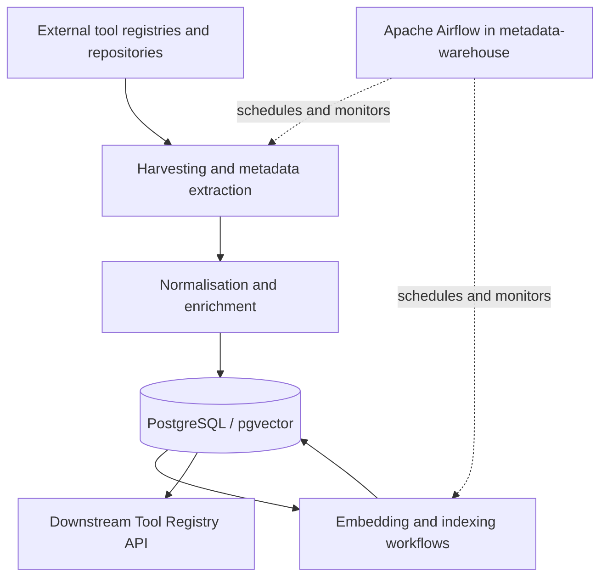

# Tool Metadata Harvester

**Metadata harvesting and enrichment pipelines for the EOSC Data Commons Catalogue of Tools.**

The Tool Metadata Harvester collects descriptions of research software, computational tools, and workflows from external registries and software repositories. It transforms source-specific records into a common metadata representation and persists them in PostgreSQL for discovery, indexing, and downstream matching services.

> **Deployment:** This project is designed to run as scheduled workflows in **Apache Airflow**. For the shared Airflow infrastructure, installation, and operational instructions, see **[EOSC Data Commons — metadata-warehouse](https://github.com/EOSC-Data-Commons/metadata-warehouse)**. This repository contains the harvester implementation and its Airflow DAG definitions; it is not a standalone Airflow deployment.

## What it does

The harvester supports the tool discovery infrastructure developed within EOSC Data Commons. Its responsibilities include:

- **Collecting metadata** from tool registries, workflow catalogues, and software repositories.
- **Normalising records** from different metadata formats into a consistent representation suitable for the Catalogue of Tools.
- **Maintaining records in PostgreSQL**, including source information and metadata updates.
- **Supporting incremental harvesting** so recurring runs can refresh existing records rather than blindly duplicating them.
- **Enriching metadata for discovery**, including generation and storage of text embeddings for semantic search.
- **Exposing harvesting workflows as Airflow DAGs** for scheduled and monitored execution.

The collection and transformation code lives in this repository. The user-facing catalogue and its search API are separate components.

## Architecture



Airflow orchestrates the pipelines and provides scheduling, task execution, logging, and monitoring. The harvester library implements the work performed by those tasks. PostgreSQL holds the harvested metadata, provenance/source information, and vector representations used by downstream search functionality.

## Repository layout

| Path | Purpose |
| --- | --- |
| `src/toolmeta_harvester/` | Python package with harvesting and metadata-processing logic. |
| `src/toolmeta_harvester/flows/` | Harvesting flows that can also be used during local development. |
| `airflow_dags/` | DAG entry points for Airflow to discover and schedule. |
| `config/` | Application configuration and local secrets configuration. |
| `docker/postgres/init/` | Initialisation scripts for the local PostgreSQL environment. |
| `pyproject.toml`, `uv.lock` | Python package metadata and dependency lockfile. |
| `Makefile` | Development helper commands. |

## Running with Apache Airflow (recommended)

The shared deployment is maintained separately in **[metadata-warehouse](https://github.com/EOSC-Data-Commons/metadata-warehouse)**. It uses Apache Airflow with CeleryExecutor, PostgreSQL, RabbitMQ, and Git DAG bundles, allowing different harvester repositories to supply their own pipelines.

To deploy this harvester:

1. Clone and configure the [`metadata-warehouse` repository](https://github.com/EOSC-Data-Commons/metadata-warehouse).
2. Install this repository as a Python package in the Airflow runtime image (scheduler, DAG processor, and workers as applicable).
3. Configure an Airflow Git DAG bundle pointing to this repository's `airflow_dags/` directory.
4. Configure the Tool Registry database connection, credentials, and other settings required by the pipelines.
5. Start the deployment and check that the DAGs are imported without errors.
6. Enable the relevant DAGs in the Airflow UI or trigger them manually.

The Airflow deployment documentation includes examples for the Python package installation and `AIRFLOW__DAG_PROCESSOR__DAG_BUNDLE_CONFIG_LIST` configuration.

**Version consistency:** Use the same Git tag or commit for the installed Python package and the Airflow DAG bundle. A DAG fetched from a newer revision may import functions that are not available in an older installed package.

### Useful Airflow commands

Run these from the `metadata-warehouse` repository:

```bash
make up                 # Start the Airflow deployment
make dags               # List discovered DAGs
make dags-errors        # Inspect DAG import errors
```

The Airflow UI is available at `http://localhost:8080` with the default local deployment configuration. Refer to [`metadata-warehouse` documentation](https://github.com/EOSC-Data-Commons/metadata-warehouse) for environment setup, service commands, and troubleshooting.

## Local development

Local development can be performed independently of the shared Airflow infrastructure. The repository provides a Makefile and a local PostgreSQL setup for running and debugging harvesting flows.

### Requirements

- Python 3.12 or newer
- [`uv`](https://docs.astral.sh/uv/) for Python environment management
- Docker for the local PostgreSQL database
- Source-specific credentials, where required (for example, a GitHub API token)

### Install

```bash
git clone https://github.com/EOSC-Data-Commons/toolmeta-harvester.git
cd toolmeta-harvester
```

Copy `.env.example` to `.env`, add local database and LLM credentials, then run:

```bash
make install
```

The Makefile starts a PostgreSQL container and installs the project dependencies. For a dependency-only setup, use:

```bash
uv sync
```

### Run a harvesting flow locally

```bash
make run
```

This target displays the available flow scripts and the command pattern for executing one; it **does not** itself start a harvesting job. Select a flow and run it, for example:

```bash
uv run src/toolmeta_harvester/flows/<flow_name>.py
```

Replace `<flow_name>` with a script present in the `flows/` directory. Some flows may require additional configuration, external service access, or a running database.

### Local database

Useful Makefile targets include:

```bash
make postgres-up       # Start local PostgreSQL
make postgres-down     # Stop local PostgreSQL
make postgres-shell    # Open a psql shell
make postgres-reset    # Remove the docker volume
```

The local database uses a PostgreSQL image with the `pgvector` extension available for embedding storage and similarity search. 

> **Warning:** Local credentials and port settings in the Makefile are intended for development. Configure secure credentials and appropriate networking for production deployments.

## Adding or maintaining a harvester

Harvesting pipelines should keep source-specific API access and metadata extraction separate from shared persistence and orchestration concerns. When introducing a new source, implement and test the source-specific extraction and transformation code in the Python package, then expose the workflow through the applicable Airflow DAG definitions.

Recurring harvesting should account for source identifiers and updates so that rerunning a pipeline does not create duplicate records. Changes to the database schema should be managed through Alembic migrations.

When adding a DAG or changing a pipeline's callable interface, update the Airflow deployment to use a matching version of the package and DAG bundle. Operational settings such as schedules, task retries, and worker configuration belong to the Airflow execution environment.

## Related repositories

- **[metadata-warehouse](https://github.com/EOSC-Data-Commons/metadata-warehouse)** — Shared Airflow infrastructure that schedules and executes harvesting DAGs.
- **[EOSC Data Commons](https://github.com/EOSC-Data-Commons)** — Organisation repositories for associated metadata, catalogue, and data discovery components.

## Project status

The project is under active development. Supported sources, metadata mappings, database models, and workflow interfaces may evolve. Consult the repository's source code and commit history for the current implementation.

## License

Licensed under the [Apache License 2.0](LICENSE).

## LLM metadata enrichment

The production path is deliberately one-step:

```text
ToolMetadata.raw_metadata -> generation LLM -> tool_metadata_enrichment
```

It does not run semantic extraction or automatic LLM-as-judge evaluation. Generated descriptions are discovery aids and are explicitly marked as AI-generated in the enrichment table. Source records and `raw_metadata` remain unchanged.

The enrichment outcomes are:

- `generated`: a non-empty description was validated and persisted.
- `skipped_empty_metadata`: the source payload was empty; no request was made.
- `insufficient_metadata`: the model reported that the payload did not support a reliable description; no description is stored.
- `failed`: a request or response could not be completed after bounded retries; any older successful attempt remains stored.
- `up_to_date`: a matching input/model/prompt result already exists.

Every attempt explicitly records whether the description is AI-generated and stores the requested model, API-reported model where available, prompt ID and version, generation timestamp, input hash, request count, Airflow run ID, and outcome. `date_modified` is useful for prioritization but does not define whether the prompt input changed. The SHA-256 input hash is calculated from the exact UTF-8 user-message text, which contains the canonical JSON representation of the full `raw_metadata` (`ensure_ascii=False`, sorted object keys, compact separators). Equal canonical inputs produce equal hashes. A result is reusable only when the hash, requested model, prompt ID, and prompt version all match. A model or prompt change therefore triggers a new attempt without removing historical results.

### Local configuration

Copy `.env.example` to `.env` and fill in the local ToolDB password and EGI key. The settings loader uses Dynaconf with `config/config.toml` defaults and `TOOLMETA_HARVESTER_` environment overrides (`SECTION__KEY` maps to nested TOML settings). Host-side `.env` uses `localhost`; the `metadata-warehouse` Airflow containers use the PostgreSQL service hostname and receive settings through that repository's Compose environment. The harvester `.env` is not automatically read by containers in the other repository.

| Variable | Purpose | Required for | Safe example/default |
| --- | --- | --- | --- |
| `TOOLMETA_HARVESTER_DATABASE__HOST` | PostgreSQL host | Enrichment and harvesting | `localhost` on host; `postgres` in Compose |
| `TOOLMETA_HARVESTER_DATABASE__PORT` | PostgreSQL port | Enrichment and harvesting | `5432` |
| `TOOLMETA_HARVESTER_DATABASE__NAME` | Database name | Enrichment and harvesting | `tooldb` |
| `TOOLMETA_HARVESTER_DATABASE__USER` | Database role | Enrichment and harvesting | `admin` (local only) |
| `TOOLMETA_HARVESTER_DATABASE__PASSWORD` | Database password | Enrichment and harvesting | Secret; set locally |
| `TOOLMETA_HARVESTER_EGI__LLM_API_KEY` | EGI bearer credential | Generation, optional validation, embeddings | Secret; set locally |
| `TOOLMETA_HARVESTER_EGI__LLM_API_URL` | Chat-completions endpoint | Generation and validation | `https://llm.ai.egi.eu/v1/chat/completions` |
| `TOOLMETA_HARVESTER_EGI__GENERATION_MODEL` | Requested generation model | Generation | `qwen3.8-27b` |
| `TOOLMETA_HARVESTER_EGI__VALIDATION_MODEL` | Requested optional review model | Manual validation only | `qwen3.8-27b` |
| `TOOLMETA_HARVESTER_EGI__EMBEDDING_API` | Embeddings endpoint | Embeddings | `https://llm.ai.egi.eu/v1/embeddings` |
| `TOOLMETA_HARVESTER_EGI__EMBEDDING_MODEL` | Requested embedding model | Embeddings | `nomic-embed-text-v2-moe` |
| `TOOLMETA_HARVESTER_EGI__LLM_TIMEOUT` | Per-request timeout, seconds | Generation/validation/embedding | `180` |
| `TOOLMETA_HARVESTER_EGI__LLM_MAX_RETRIES` | Maximum configured retry attempts | Generation and validation | `3` |
| `TOOLMETA_HARVESTER_GITHUB__API_KEY` | GitHub API credential | GitHub harvesting only | Optional secret; not needed for enrichment |

The local harvester `.env` contains actual local database and EGI credentials and is Git-ignored. The sibling `metadata-warehouse/.env` separately supplies Airflow's database settings, EGI key and embedding endpoint. Its Compose file currently leaves the other EGI endpoint/model/timeout settings at the checked-in TOML defaults; to override those for Airflow, define the variables in that `.env` and pass them through the Airflow service environment. Production must provide secrets through its deployment secret store, not either repository's committed files.

### Airflow operations

`tool_metadata_enrichment` is manual by default. Trigger with one of:

```json
{"limit": 100}
```

```json
{"tool_ids": ["<uuid>", "<uuid>"]}
```

```json
{"full_catalog": true}
```

A full-catalog run is explicit and should be coordinated with database/API capacity planning. Airflow maps records into batches of 10 (bounded concurrency), while each record attempt is committed separately. After the mapped generation batches finish, one Airflow Asset event starts `tool_metadata_embedding`, which independently maps all current results missing vectors into bounded batches. Validation is not part of that dependency chain.

`tool_metadata_validation` is an independent manual DAG. It accepts `tool_ids`, `enrichment_ids`, or a bounded `limit` (maximum 1000). Its results are stored in `tool_metadata_enrichment_validation` and never change generated text or its status.

`tool_metadata_processing_report` runs without an LLM call. Supply an enrichment `run_id`, or `since` and `until` ISO timestamps. Without parameters it reports the previous 24 hours. It reports selected outcomes, failures and IDs, request/retry totals, duration, average generation latency, throughput, and the remaining catalog count not represented in the selected interval.

### Database migrations

Alembic in this repository owns versioned enrichment schema changes. The normal harvesting initializer only creates or updates the source metadata tables; it never creates enrichment tables with `create_all()`.

For an existing ToolDB, use the same `toolmeta-harvester` checkout/tag as the DAG package and run:

```bash
uv sync --frozen
uv run alembic current
uv run alembic upgrade head
```

Review the reported current revision before applying the upgrade. The production migration is additive and keeps old experimental rows and harvested source data. Do not run schema changes against production until the migration has been reviewed and tested in staging. For a new local database, initialize the ordinary harvester schema first, then apply Alembic migrations. See [the Airflow and database runbook](docs/airflow-runbook.md) for deployment ordering and verification queries.

### Manual review query

This query shows source metadata, the latest enrichment attempt and its provenance, optional validation records, and embeddings for manual quality checks:

```sql
SELECT
    tm.id AS tool_id,
    tm.title,
    tm.metadata_format,
    tm.source_url,
    tm.date_modified,
    tm.raw_metadata,
    e.id AS enrichment_id,
    e.status AS enrichment_status,
    e.enriched_description,
    e.is_ai_generated,
    e.requested_model,
    e.actual_model,
    e.prompt_id,
    e.prompt_version,
    e.input_hash,
    e.generation_timestamp,
    e.run_id AS airflow_run_id,
    e.request_count,
    e.elapsed_seconds AS generation_seconds,
    e.error_code,
    e.error_message,
    COALESCE(v.validation_results, '[]'::jsonb) AS validation_results,
    COALESCE(b.embeddings, '[]'::jsonb) AS embeddings
FROM tool_metadata AS tm
LEFT JOIN LATERAL (
    SELECT *
    FROM tool_metadata_enrichment AS candidate
    WHERE candidate.tool_id = tm.id
    ORDER BY candidate.generation_timestamp DESC, candidate.id DESC
    LIMIT 1
) AS e ON TRUE
LEFT JOIN LATERAL (
    SELECT jsonb_agg(jsonb_build_object(
        'status', val.status,
        'requested_model', val.requested_model,
        'actual_model', val.actual_model,
        'prompt_id', val.prompt_id,
        'prompt_version', val.prompt_version,
        'result', val.result,
        'error', val.error_message,
        'created_at', val.created_at
    ) ORDER BY val.created_at DESC) AS validation_results
    FROM tool_metadata_enrichment_validation AS val
    WHERE val.enrichment_id = e.id
) AS v ON TRUE
LEFT JOIN LATERAL (
    SELECT jsonb_agg(jsonb_build_object(
        'model', emb.embedding_model,
        'actual_model', emb.actual_model,
        'text', emb.text,
        'created_at', emb.created_at
    ) ORDER BY emb.created_at DESC) AS embeddings
    FROM tool_metadata_enrichment_embedding AS emb
    WHERE emb.enrichment_id = e.id
) AS b ON TRUE
ORDER BY tm.title NULLS LAST, tm.id
LIMIT 100;
```

Previous A/B sample reports under `experiments/` are retained as historical evidence. They are not used by the production DAGs.
